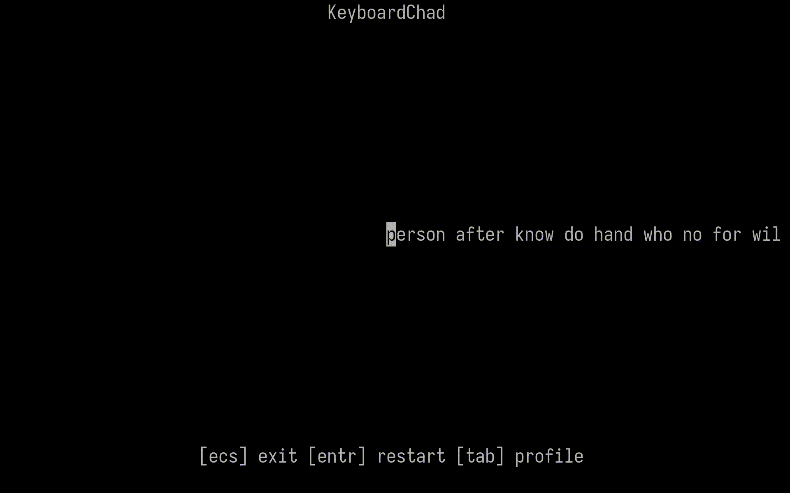

# KeyboardChad —  tui typing app



### Installation(C++20)
Linux:
```bash
git clone https://github.com/swoopezz/KeyboardChad && cd KeyboardChad
./install.sh 
kbchad # dict will be created automatically
```

### Build(C++20)
Linux:
```bash
git clone https://github.com/swoopezz/KeyboardChad && cd KeyboardChad
cmake -S . -B build && cmake --build build 
build/kbchad # dict will be created automatically
```

### Configuration
WordLists directory: $HOME/.local/share/kbchad/

Config path(rebuild required): src/config.hpp
```c++
namespace kbchad::config {
	// number of words in a single wpm test
	constexpr unsigned int WORD_COUNT    = 25;
	// min accuracy in percent required to save test
	constexpr unsigned int MIN_ACCURACY  = 80;

    	// style applied to characters that were typed INCORRECTLY
	constexpr tui::Pixel_Style ERROR = {
		.mode = tui::Pixel_Graphic_Mode::STRIKE,
		.fg   = tui::Pixel_Fg_Color::RED,
		.bg   = tui::Pixel_Bg_Color::DEFAULT,
	};

    	// style applied to characters that were typed CORRECTLY
	constexpr tui::Pixel_Style FINE = {
		.mode = tui::Pixel_Graphic_Mode::BOLD,
		.fg   = tui::Pixel_Fg_Color::DEFAULT,
		.bg   = tui::Pixel_Bg_Color::DEFAULT,
	};

    	// style applied to the CURRENT cursor posit
	constexpr tui::Pixel_Style CURSOR = {
		.mode = tui::Pixel_Graphic_Mode::INVERSE,
		.fg   = tui::Pixel_Fg_Color::DEFAULT,
		.bg   = tui::Pixel_Bg_Color::DEFAULT,
	};
};
```
